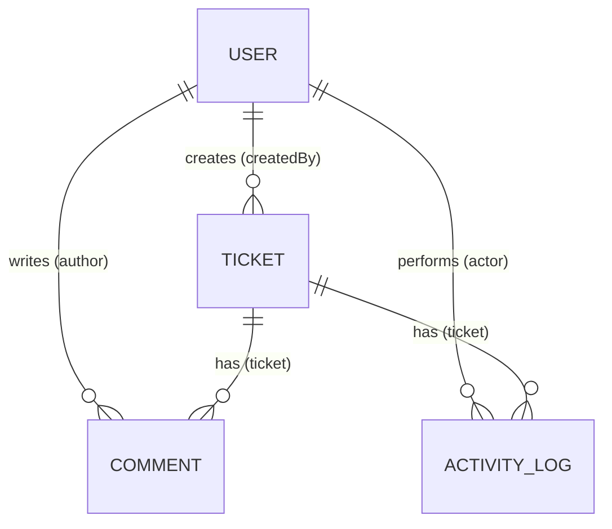

# Support Ticket Management System (Mini Helpdesk)

Backend-first implementation for the Humanli.ai assignment: users can register/login, create and manage their own support tickets, comment on tickets, and admins can manage all tickets (filtering + status/priority updates). Important actions emit domain events and are persisted into an **activity log**.

## Tech Stack
- **Backend**: Node.js, Express.js, TypeScript
- **Frontend**: React (Vite) + React Router
- **Database**: MongoDB (Mongoose)
- **Auth**: JWT (Bearer tokens) + bcrypt password hashing
- **Validation**: Zod
- **Docs**: Swagger UI (`/docs`)

## Database Design (MongoDB)

MongoDB was chosen because the data is document-shaped (a ticket with comments and an activity trail), the schema is still changing during development, and Mongoose gives schema validation on top of it.

### Entity relationship



### Collections

**`users`**

| Field | Type | Notes |
|---|---|---|
| `name` | String | 2–80 chars |
| `email` | String | Unique, lowercased (unique index created by Mongo via `unique: true`) |
| `passwordHash` | String | bcrypt hash, never returned by the API |
| `role` | `'user' \| 'admin'` | Defaults to `user`; admins are created with the seed script |
| `createdAt`, `updatedAt` | Date | Mongoose timestamps |

**`tickets`**

| Field | Type | Notes |
|---|---|---|
| `createdBy` | ObjectId → `users` | Indexed; owner of the ticket |
| `title` | String | 3–120 chars |
| `description` | String | 3–5000 chars |
| `category` | String | 2–60 chars (free text, e.g. Auth, Billing) |
| `priority` | `low \| medium \| high \| urgent` | Indexed; defaults to `medium` |
| `status` | `open \| in_progress \| resolved \| closed` | Indexed; defaults to `open` |
| `createdAt`, `updatedAt` | Date | Mongoose timestamps |

Indexes: `{ createdBy: 1, createdAt: -1 }` for "my tickets" lists, plus single-field indexes on `priority` and `status` for admin filters.

**`comments`**

| Field | Type | Notes |
|---|---|---|
| `ticket` | ObjectId → `tickets` | Indexed |
| `author` | ObjectId → `users` | Indexed; the user or admin who wrote it |
| `body` | String | 1–2000 chars |
| `createdAt`, `updatedAt` | Date | Mongoose timestamps |

Index: `{ ticket: 1, createdAt: 1 }` for chronological comment threads.

**`activitylogs`** (the event log)

| Field | Type | Notes |
|---|---|---|
| `eventType` | enum | `ticket.created`, `ticket.updated`, `ticket.status_changed`, `ticket.priority_changed`, `comment.added`, `ticket.resolved` |
| `actor` | ObjectId → `users` | Indexed; who triggered the event |
| `ticket` | ObjectId → `tickets` | Indexed |
| `metadata` | Mixed | Event payload, e.g. `{ from: 'open', to: 'resolved' }` or `{ commentId }` |
| `createdAt`, `updatedAt` | Date | Mongoose timestamps |

Index: `{ ticket: 1, createdAt: -1 }` for a ticket's history.

### Design decisions
- **References, not embedding, for comments and activity.** A ticket can grow without limit, and admins need to filter and paginate tickets without loading every comment. Comments and activity live in their own collections and are fetched per ticket.
- **Activity log as a separate collection.** It is append-only and kept apart from the ticket document. Each important action writes one record, so there is a full audit trail even when a ticket changes many times.
- **Event-driven writes.** Controllers emit domain events (`ticket.created`, `comment.added`, …) on an in-process event bus. Listeners in `src/events/registerListeners.ts` write the activity records. This keeps the request handlers focused on the main action, and listeners can later send notifications or emails without changing the handlers.
- **Denormalized actor/owner IDs.** `createdBy`, `author`, and `actor` store only the user ID. Names and emails are populated at read time, so a user's details live in one place.
- **Cascading delete.** When an owner deletes an open ticket, its comments and activity are removed too, so no orphaned records are left behind.
- **Status gates edits.** The owner can edit or delete a ticket only while its status is `open`. Once an admin starts work, the ticket is locked for the owner and changes go through the admin endpoints.
- **Enums enforced twice.** Zod validates request bodies, and Mongoose enforces the same enums in the schema, so bad data is rejected at the API and at the database layer.

## Testing

The backend has automated API tests (Vitest + Supertest) that run against an in-memory MongoDB, so no database needs to be running.

```bash
cd backend
npm test
```

Coverage (21 tests in `backend/tests/api.test.ts`):
- **Auth**: register with default role, duplicate email, wrong password, `/me` requires a valid token
- **User access rules**: create defaults, invalid body, users only see their own tickets, 403 on another user's ticket, malformed ID, owner can edit only while `open`, delete cascades to comments and activity
- **Comments**: owner can comment, other users are forbidden, admin can comment on any ticket
- **Admin**: non-admins get 403, list and filter by status and priority, priority and status changes record activity (including `ticket.resolved`), invalid status is rejected, ticket details include comments and activity

## Quick Start (Docker)
Prereqs: Docker Desktop

```bash
docker compose up --build
```

API will run on `http://localhost:4000`
- Swagger UI: `http://localhost:4000/docs`
- Health: `http://localhost:4000/health`

## Local Dev (without Docker)
Prereqs: Node.js 20+, MongoDB running locally

### 1) Backend
```bash
cd backend
npm install
cp .env.example .env
npm run dev
```

### 2) Frontend (new terminal)
```bash
cd frontend
npm install
cp .env.example .env
npm run dev
```

Open `http://localhost:5173`

### Easy test mode (no local Mongo install)
If MongoDB is not installed, run the API with in-memory Mongo:

```bash
cd backend
npm run build
npm run start:mem
```

Then start the frontend as above.

## Create an Admin User
User registration defaults to role `user`. Use the seed script to create an admin:

```bash
cd backend
npm run seed:admin -- --email admin@example.com --password StrongPass123 --name Admin
```

For `start:mem`, use the printed `[memory-mongo] uri:` value:

```bash
MONGODB_URI='mongodb://127.0.0.1:PORT/' JWT_SECRET='change_me_in_real_env_change_me' npm run seed:admin -- --email admin@example.com --password StrongPass123 --name Admin
```

## Key API Endpoints
All authenticated endpoints require `Authorization: Bearer <JWT>`.

## API Documentation
- **Swagger UI**: `GET /docs`
- **Postman collection**: `postman/Humanli-Helpdesk.postman_collection.json`

### Auth
- `POST /api/auth/register`
- `POST /api/auth/login`
- `GET /api/auth/me`

### Tickets (User)
- `GET /api/tickets` (list my tickets)
- `POST /api/tickets` (create ticket)
- `GET /api/tickets/:id` (owner or admin)
- `PATCH /api/tickets/:id` (owner-only; **only if status is `open`**)
- `DELETE /api/tickets/:id` (owner-only; **only if status is `open`**)
- `GET /api/tickets/:id/comments` (owner or admin)
- `POST /api/tickets/:id/comments` (owner or admin)
- `GET /api/tickets/:id/activity` (owner or admin)

### Admin
- `GET /api/admin/tickets` (filter by `status`, `priority`, `userId`, `search`, paginate with `page`, `limit`)
- `GET /api/admin/tickets/:id` (ticket + comments + activity)
- `PATCH /api/admin/tickets/:id` (update `status` and/or `priority`)
- `GET /api/admin/activity` (global activity feed)

## Event Handling (Activity Log)
The API emits domain events for:
- Ticket Created
- Ticket Updated
- Status Changed
- Priority Changed
- Comment Added
- Ticket Resolved

Events are handled via an in-process event bus and persisted in `ActivityLog` for traceability.

